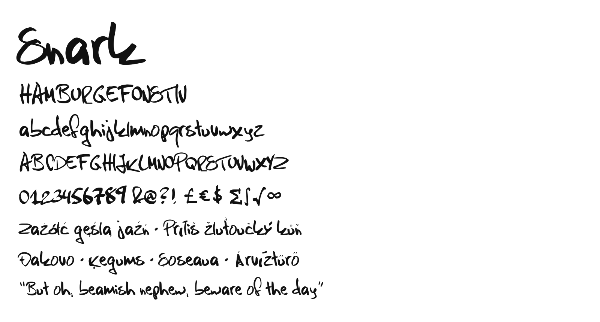

# Snark

A marker-hand display typeface by Linus Areng. One weight, Latin.



Snark is a felt-tip hand written at speed. No two letters lean quite the same way
and the baseline wanders, but the strokes are decisive and the bowls stay round
and open. The letterforms are the designer's own hand, from Swedish games
magazines where headlines were scrawled fast and loud.

It covers the Google Fonts Latin Core character set in full.

## Building

```sh
python3 -m venv venv && source venv/bin/activate
pip install -r requirements.txt

cd sources && gftools builder config.yaml
```

Output lands in `fonts/ttf/`. CI runs the same build plus FontBakery on every
push, and fails the build on any FontBakery error.

## Source

`sources/Snark.glyphs` is the canonical source — build from it, not from the
compiled binaries. Vertical metrics, `fsType` and the OFL name records are set
as Glyphs custom parameters so they survive rebuilds.

## License

[SIL Open Font License 1.1](OFL.txt). No Reserved Font Name.
